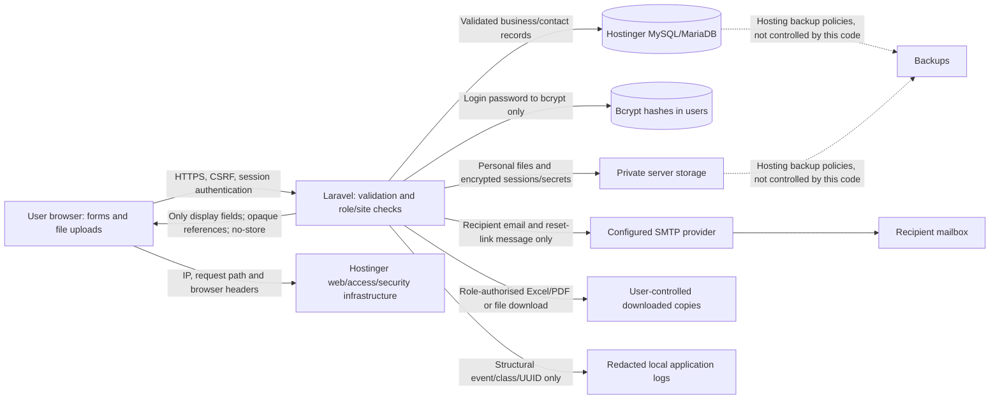

# SiteTrack personal-data audit — 24 October 2026 (IST)

This audit covers first-party application code, Blade forms, browser assets, authenticated AJAX and download routes, model serialization, Laravel logs/errors/mail/session settings, uploads, exports, seed data and tests. The changes below are implemented, not just recommendations. The audit tooling did not extract production account records or hosting-side configuration; the deployed startup migration processes the stored fields necessary for cleanup. Public deployment checks and the repository tests are distinguished from hosting/provider checks that need separate access.

The previous admin password-reveal feature has intentionally been removed to comply with the new hash-only requirement. The existing password field can set a replacement; it cannot reveal an existing password.

## Data movement at a glance

A browser necessarily holds form data in memory while the person types, and PHP receives request data in memory while processing it. Login passwords are never persisted or sent to an integration: Laravel validates and checks/hashes them. Server-side temporary uploads, sessions, reset tokens, business records and intentional exports are separate storage paths documented below.

## Collection and destination map

[CSV inventory of every form/partial](privacy/collection-points.csv) and [JSON inventory](privacy/collection-points.json) enumerate the source view, action, method and exact input names, including repeated material/labour rows, filters and included modals. Server-only collection and destinations follow here.

| Entry point | Personal/sensitive data collected | Processing and durable destination | Further recipients / outputs | Retention or erasure |
|---|---|---|---|---|
| `POST /` | Username and login password; connection IP | Server validation, bounded bcrypt verification, active-account/role check; encrypted file session containing guard identity/password-hash stamp. Password input is not persisted. Rate-limit account/IP keys use keyed HMACs in Laravel cache. | Session cookie containing an encrypted opaque session identifier. Same generic failure for unknown, incorrect and disabled accounts. | Session idle lifetime defaults to 120 minutes; limiter windows up to 15 minutes. Deletion revokes account sessions. |
| `POST /forgot_password` | Email address; connection IP | Active user lookup; hashed reset token plus email and creation time in `password_reset_tokens`. No password copy. | SMTP receives the recipient email and a reset-link message. Unknown and eligible addresses get the same browser response. | Token expires in 60 minutes, is throttled, and is removed after successful reset/deletion/pruning. Recovery limiter keys expire within an hour. |
| `GET /reset-password`, `POST /reset-password` | Token from browser fragment; manually entered account email; new password/confirmation | Fragment is copied into a hidden form field then removed from history; server verifies the hashed token and writes a bcrypt hash. | No email or new token appears in new reset URL paths/query strings. No password email. Legacy token-path links redirect to the fragment for compatibility. | Single-use token, 60-minute expiry. Browser password fields are blank on validation failures. Old links issued before the audit can already exist in access logs/mailboxes. |
| `POST /user/profile` | Own name, username, email, phone and optional photo | Allowlisted profile fields in `users`; image is renamed and stored on private local `personal/profile` disk, with new image metadata stripped. | Own profile; explicitly authorised account management. No default API model dump. | Until changed or deleted; uploaded old profile files require orphan-file review if no longer referenced. |
| `POST /user/add_user`, `/user/edit_user/{reference}` | Name, username, email, phone, role, optional photo, initial/replacement password | Admin capability checks and server validation; bcrypt only; `user_vpassword` is empty. User model hides password fields. | Account managers can see the fields needed to manage staff; read-only user-directory permission returns the current account only. | Account deletion removes the person’s row/credentials/photo. New blank edit-password input preserves the existing hash. |
| `POST /user/change_password` | Current password, new password and confirmation | Bcrypt verification/hash and session renewal; other previously established sessions fail their password-hash stamp check. | No separate AJAX password-check request remains. No recoverable copy, mail, API or log output. | Inputs remain request-memory-only; new hash persists until replaced/deleted. |
| Client add/edit | Client name, email, phone, postal address | `clients` through `ClientController` validation | Client-directory readers/managers see only actual display fields and permitted forms. No third-party call. | Business/contact retention until authorised editing/anonymisation. Contacts are not inherently linked to login accounts. |
| Subcontractor add/edit | Name, email, phone, postal address | `subcontractors` through `SubcontractorController` | Directory, labour attendance, ledgers and authorised reports/Excel display needed business identity. | Business retention; separate contact erasure may require an administrator because login-account ownership is not recorded. |
| Vendor add/edit | Contact name, company, primary/alternate phone, location/address, service/type, remarks and optional card/document | `vendors`; renamed document on private `personal/vendor` disk | Directory response excludes alternate phone, remarks, file path and audit fields unless an explicit form/export needs them. Private file permission check. Vendor Excel intentionally includes contact columns/remarks for its separately authorised export. | Business retention; private document until replaced/erased. Historical file copies/exports need separate handling. |
| Company/settings forms | Company/contact name, email, phone, address and branding images | `settings`; branding remains public by design | Site title/logo/favicon; full company/contact and SMTP settings are restricted to their configuration permissions. | Until changed; these fields may identify a sole trader/contact. Public branding can be cached or downloaded externally. |
| SMTP settings | Server host/port, sender email/name, SMTP login and secret | Host/login/sender fields in `settings`; SMTP secret encrypted outside the database at `storage/app/private/personal/integration-secrets/smtp.enc`; legacy `settings_pwd` cleared | SMTP transport necessarily uses its service credential. It is not a user login password and cannot be hashed if the transport is to authenticate. Secret field is blank/masked in HTML and hidden in serialization. | Until replaced. Protect APP_KEY separately. Retained infrastructure backups may contain older credentials. |
| Project add/edit and BOQ spreadsheet import | Site name/location, client, assigned engineer, dates, budget; spreadsheet descriptions/remarks that may contain names/addresses | `projects`, `project_boqs`; PHP/Excel temporary files during validation/import; creation/import is transactional | Role-authorised directory, workspace, BOQ/QMS/exports. Spreadsheet parsing and PDFs run locally. | Business retention; temporary files normally removed after the request, stale files pruned after 24 hours if scheduled. |
| DWR / DPR add/edit/status/verification | Site/date/location, work/remarks, assigned in-charge/subcontractor, quantities, optional site photos, review/correction notes | `daily_works`, `daily_progress`, `progress_reviews`, `progress_events`, `progress_photos`; private evidence files | Project-scoped viewers/reviewers, explicit downloads. History display projects snapshots onto work/decision fields and omits raw IDs, actor metadata and storage paths. Actor display name is needed for the approval history. | Business history retained. Account deletion anonymises attribution and removes that user’s uploaded progress photos. Free text is reviewed as described below. |
| Site materials, receipts, returns and usage | Site/date, author identity, usage notes, quantity/rate/cost | `assign_materials`, `return_materials`, `site_material_usage`, inventory records | Project-scoped operational screens and explicit material Excel/PDF reports. | Business retention; author links anonymised at account deletion. |
| Indents, items and quotation approvals | Site/engineer, request notes, approval notes, material quantities, vendor, rate/total, delivery text and quotation attachment | `indents`, `indent_items`, `indent_quotations`; private `personal/quotation` files | Module/site-authorised request/quotation viewers; separately permitted Excel and private attachment download. | Business retention. Attachments may contain personal contact/payment details in their contents. |
| Issues and resolution | Title/description/remarks, date/site, assigned/raising person, optional image | `issues`; private `personal/issue` files | Issue readers for the selected site; authorised issue exports. | Business retention; account attribution anonymised. |
| Labour attendance | Date/site, subcontractor, in-charge, trade/skill, shift/times, male/female headcounts, wages and overtime | `labour_trackers`, `labour_workers`; server-calculated wages | Authorised attendance/payment reviewers and explicit labour reports/Excel/PDF | Business/financial retention. No individual worker names or DOB fields; small crews can still make aggregate wages/gender information identifiable. |
| Labour payments/advances and vendor/subcontractor ledgers | Payee identity, site/trade, date/type, amount, invoice/WO/PO/reference text, paid/outstanding amounts and notes | `labour_payments`, `vendor_ledger`, `subcontractor_ledger` | Finance/module-authorised screens and explicit downloads. Project-filtered ledger views/AJAX/exports now preserve the filter. | Business/financial retention; no card processor. Notes/reference fields can contain additional personal/bank data if entered. |
| Every authenticated business mutation | Added/updated actor IDs and timestamps; reviewers/uploaders | Relevant database audit columns, progress event records | No raw actor/audit IDs in DataTable payloads. Browser route/form references are opaque, resource-bound ciphertext. | Account deletion rewrites links to a shared disabled anonymous account. Numeric inbound legacy links remain accepted for compatibility, with the same role/site checks. |
| Every HTTP request | Network IP, user-agent/browser headers, cookies, requested path, possibly Accept-Language | PHP receives them transiently. App does not create device fingerprints or persist user-agent/language. Sessions use files rather than Laravel’s IP/user-agent database-session driver. | Hostinger web server/CDN/WAF/access infrastructure necessarily sees connection/request metadata. Exact enabled services and their logs were not inspected. | Hosting retention is outside application control. No production hosting log contents were read or erased by this repository change. |
| Browser preferences | Night/light mode; sidebar/layout/theme choices | `localStorage.screenModeNightTokenState` and `sessionStorage.__THEME_CONFIG__` | Browser only. Despite the legacy word “Token”, the night-mode value is a theme preference, not an authentication token. | Preference remains until cleared/browser storage ends. No email, name, phone, password or auth token is written to web storage by application code. |
| Account deletion | Current password and explicit `DELETE` confirmation | Password verification; transaction removes profile/credentials, sessions and tokens; anonymises linked business rows and known identity text; deletes profile/uploaded progress files | No deletion email or external API call | Irreversible. Last active primary administrator must create another administrator first. |

No dedicated date-of-birth, card number, CVV, bank-account or identity-document-number field was found. This does not mean those data cannot appear in notes, photos, vendor cards, quotations or spreadsheets. Structured-field validation cannot reliably detect every personal detail pasted into free text or a document.

## Third-party integration audit

| Integration / library | Actual application use | User data sent | Changes / conclusion |
|---|---|---|---|
| Configured SMTP transport | Active password-reset delivery | Recipient email, sender address/name, fixed subject and a one-use reset link; service credential for transport authentication. Standard delivery metadata may be retained by the provider/mailbox. | No display name, phone, address, account ID, password, user model, business record or attachment is included in reset mail. No automatic CC/BCC. Mail `log` transport changed to a non-logging array transport so a misconfigured logger cannot persist the link. Exact live SMTP hostname/provider not inspected. |
| Hostinger hosting/database | Runs the app; stores the DB, private files, logs and possibly hosting backups | All server-held categories in the map; browser connection/request metadata | App log payloads redacted; private file boundary and encrypted sessions implemented. Hosting logs/backups/WAF/cron configuration require separate hosting-side verification. |
| Laravel Mailgun/Postmark/SES, broadcasting/Pusher/Ably, S3, Slack/Papertrail config entries | Framework configuration templates; no first-party SDK initialisation/call sending app data to those services was found | No active first-party data path found in code. A separately configured mail transport still receives the minimal reset message. | Personal/evidence uploads and Excel temporary storage are explicitly local/private; logging defaults to local redacted daily logs. Templates alone are not evidence of an active integration. Live environment overrides outside the repository remain an audit boundary. |
| jQuery, Bootstrap, Select2, DataTables, charts, date pickers, Tabler icons/fonts | Self-hosted browser UI libraries | UI processing in the browser; own-origin AJAX endpoints | No analytics/error-tracking SDK initialisation found. License/documentation URLs inside bundled assets are not themselves outbound requests. Runtime origin checks are included in verification. |
| Laravel/Sanctum/Auth0 | Laravel session authentication; unused default `/api/user` model-dump endpoint removed | No external identity provider receives credentials | Auth0 is not used; no active token-issuing/mobile API found. Legacy API tokens are purged. |
| Dompdf and PhpSpreadsheet/Maatwebsite Excel | Local PDF generation and spreadsheet import/export | None to an external API as part of generation | Remote/PHP execution is disabled for PDFs; private local temporary files, 0700/0600 permissions, no remote temp disk; legacy export text cannot become executable Excel formulas/external-data requests. Download recipients can intentionally share files afterward. |
| Payment processors, analytics, AI APIs, advertising, external error tracking | None found in first-party application use | None found | Payment records are bookkeeping records, not payment-gateway transactions. No OpenAI/AI request path was found. |
| GitHub repository and CI | Code and synthetic fixtures are fetched/built/tested | Repository contents and workflow metadata, not runtime DB rows | Seed fixtures sanitised; committed personal images/documents removed. Previously committed PII/password copies can remain in old commits and external clones. History was not rewritten or force-pushed. |

## Logging and error-handler fixes

The only first-party runtime logger previously emitted a fixed mail-delivery warning. The larger exposure was Laravel’s default exception reporting: a QueryException can contain SQL/bindings, and an SMTP exception/log mailer can contain recipients or message contents.

Implemented controls:

- `Handler::report()` records an allowlisted event identifier, a real exception class and an optional generated correlation UUID, never an exception object, message, request, user, SQL/bindings or trace arguments.
- A Monolog processor removes arbitrary message/context/extra values before handlers run, including emergency logging. Unknown free-form messages become `[REDACTED]`. Event/class/UUID fields have strict semantics rather than a permissive string mask.
- Application logs default to local daily rotation, private file permissions and seven-day retention. Old application `*.log*` contents are replaced during the privacy migration. Hosting/PHP process logs outside `storage/logs` are not owned by this app.
- Generic server/DataTable errors replace raw exception/SQL details. Production debug is disabled. Passwords/secrets/tokens are never flashed as old form input; old ordinary form values are held only in encrypted server sessions.
- The unused demo `console.log` was removed. First-party source and loaded asset searches found no application console logger transmitting personal values.

The code no longer has enough free-form exception detail in logs to reconstruct a SQL binding or SMTP payload. Debugging uses event/class/UUID and controlled local reproduction with synthetic data.

## Storage, identifiers and response boundaries

- User login passwords: bcrypt hash only. Recoverable legacy column blanked without changing login hashes; vault/reveal code and its Artisan command removed.
- SMTP service secret: separately encrypted private file; never prefilled or serialized. It must be decrypted for the SMTP transport, unlike a login password.
- Session: encrypted private server file. Cookie: encrypted opaque identifier, HttpOnly, Secure for production/HTTPS, SameSite=Lax. JavaScript-readable XSRF cookie disabled; hidden/meta CSRF values remain intentionally usable by the app.
- Browser storage: theme/layout only. No PII/authentication data is written to localStorage/sessionStorage by first-party code.
- Personal uploads: new writes use private disks with random filenames; new profile/vendor/issue/evidence images are re-encoded without EXIF/GPS/camera metadata. Existing files are moved out of public upload directories. Private routes enforce authentication, capability, ownership or selected-site checks. Static legacy paths are denied at the web-server rules and legacy files are moved on startup; test the hosting server’s static rules as part of deployment.
- Historical uploads can retain metadata inside their original contents: moving a legacy document/image is not the same as re-authoring it. Those files stay private. Administrator review is needed if old document/metadata contents themselves require erasure.
- DataTables: explicit required display fields, no model/relationship dump, no raw primary/foreign/audit keys or filesystem names; users without management rights get their own account only. Necessary business contact names remain visible to roles explicitly permitted to view/manage that directory or report.
- Opaque record references: URLs, form option/hidden values and modal actions use encrypted resource-bound references; existing inbound numeric links remain compatible. They are not substitutes for the role/site checks. Browser row numbers, revision/status/quantity values remain ordinary numbers.
- Approval history: only work/review fields are projected for display; raw snapshot IDs, private paths and irrelevant model metadata are omitted.
- HTML form pages intentionally show the permitted person’s editable fields. A staff manager editing another account is an authorised data-management operation; the own-profile/deletion paths never accept a target-user ID.
- Excel/PDF downloads remain an intentional data-transfer point with separate download permissions. Once downloaded, browser/OS/mailbox copies are outside server-side deletion.

## Deletion and retention

“My profile → Delete my account” requires current-password verification, CSRF protection, a rate limit, and typing DELETE. It cannot delete an arbitrary submitted account ID. It removes the user row, password/legacy-copy fields, contact details, profile image, that user’s uploaded progress photos, reset/API tokens and file/database sessions. A common disabled anonymous identity replaces account links in construction records. Known name/username/email/phone strings are redacted within records linked to that person, including associated progress history; raw snapshot actor identifiers are anonymised. The last active primary administrator must hand over administration first. Inactive users who cannot sign in need administrator-assisted erasure.

This is a bounded, implemented erasure flow, not a claim that arbitrary documents can be perfectly anonymised. It cannot identify unknown personal details in every upload/note, infer that a client/vendor record belongs to a login account without an ownership relationship, or delete previously exported copies, provider mail, external logs, backups, old Git commits or clones. Administrator/provider erasure and retention processes are needed for those copies. The app retains business quantities/payments/approval history with anonymous attribution; it does not promise legal/accounting retention compliance for a particular jurisdiction.

| Store | Implemented retention | Verification / dependency |
|---|---|---|
| Reset tokens | 60-minute validity, single-use; expired rows removed by pruning | Token expiry/replay tested; scheduled physical pruning depends on cron. |
| Login/recovery limiter cache | Short bounded TTL: per-minute limits; login up to 15 minutes; recovery account up to an hour | Limits tested including rotating usernames/IPs; HMAC keys reduce direct identifier exposure. |
| Sessions / temporary old form values / reference map | Encrypted server files, default 120-minute idle lifetime; session invalidation and pruning | Cookie/encryption/deletion tested. Existing pre-audit sessions/reset/API tokens purged on upgrade. |
| Excel/PHP upload temporary files | PHP/request cleanup; stale spreadsheet temp files older than 24 hours removed by pruning | Private 0700/0600 directory/file permissions; remote temp storage disabled. |
| Application logs | Redacted diagnostics, seven days; pre-audit log contents removed on upgrade | Log processor and legacy cleanup tested. Rotation happens when logging; pruning provides independent cleanup if scheduled. |
| Account data and personal uploads | Until replacement/deletion; no blanket automatic deletion of active accounts | Account deletion tested. Unreferenced old upload versions require admin review. |
| Business/contact/financial records | No universal expiry was previously configured; retained business history is anonymised on account deletion where linked | Retention policy still needs an owner/jurisdiction decision; unrelated contact records require administrator action. |
| Hosting access/WAF/PHP logs, backups, SMTP/mailboxes, exported files, Git history | Not governed by this application | Not inspected or erased; separate owners, retention periods and erasure requests are required. |

`privacy:prune` is scheduled daily by Laravel. Hostinger must run `php artisan schedule:run` every minute for that schedule to execute; this audit cannot confirm the hosting cron exists. The command can also be run manually. After restoring old backups, repeat `php artisan privacy:upgrade --force` before exposing the restored app.

## Deployment and verification

No schema migration or SQL import is required for these fixes. The checked-in `database.sql` is now synthetic development data; never import it over the live database. Privacy startup runs before the first application web request is served and writes a private completion marker only after cleanup succeeds. It removes recoverable password copies, relocates public personal files, removes pre-audit logs/temporary sessions/reset/API tokens/queued payloads, and migrates SMTP credentials. Failures return a generic temporary-maintenance response rather than exposing an unclean deployment. Existing users need to sign in again once. `X-SiteTrack-Privacy: v3` on an application response indicates that startup completed on that deployed filesystem; it does not certify provider/backups or external systems. A nonpersonal global migration run ID is exposed only to verify that private storage survives subsequent deployments; it is not a user/session identifier.

Verification covers all table allowlists, own-account directory scope, opaque reference round trips and wrong-resource rejection, private file access, cookie/session encryption, log redaction including exception contexts, legacy cleanup, password/reset flows, account deletion, metadata stripping, Excel formula handling, and the existing project/approval/inventory/wage/report workflows. Browser checks exercise actual CSRF-enabled forms and capture request origins. The release’s test count and live check results are recorded in the task delivery message.

Open infrastructure checks: exact SMTP provider/retention; actual Hostinger access/WAF/PHP-log and backup policies; scheduler cron; old Git history/clones; copies already downloaded or emailed; content-level review for historical documents and unstructured data. These are explicitly outside what a repository audit and public HTTP checks can prove.

Release verification: 38 tests passed with 1,753 assertions against a freshly imported synthetic test database. Browser checks covered 12 screens with zero script errors, zero failed requests and zero external request origins; only theme configuration appeared in browser storage. The first live release returned the v3 completion header, Secure/HttpOnly/SameSite=Lax session-cookie flags, and HTTP 403 for unauthenticated legacy profile, vendor, issue and quotation files.
